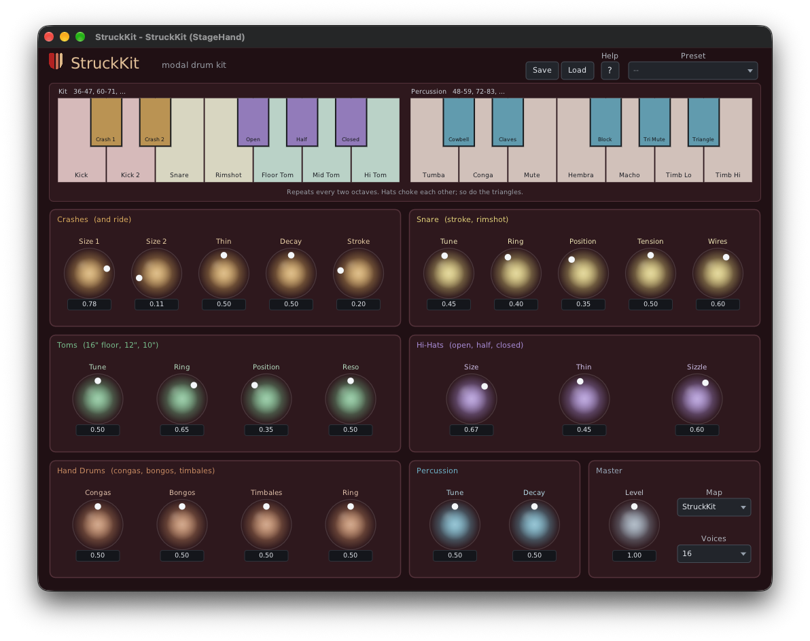

# StruckKit

A physically modelled drum kit from Unlikelyware, in one instance: snare with wires, two-headed
toms, crashes, ride and hi-hats, plus an octave of hand drums and small percussion. Built on
[StruckSynth](https://github.com/erickampman/StruckSynth)'s modal engine.



| | |
|---|---|
| Formats | CLAP. VST® 3 and AUv2 (macOS) build from source; ready-built in a later preview |
| Platforms | Linux x86-64, macOS 26 or later on Apple Silicon. No Windows |
| Version | 0.9.0 (preview) |
| License | MIT |

**Downloads:** ready-built plugins will be on itch.io with the 0.9 preview. This repo has the
source only.

## What makes it different

- **Models, not samples.** The snare is two coupled heads and eight wire strands; the toms have a
  resonant head you can tune; the cymbals are bronze plates of about 1000 modes that bloom into a
  wash when hit hard; the hi-hat's bottom cymbal chatters against the top one. Every hit is
  different, and every drum rings out past note-off.
- **Controls are physical quantities.** Cymbal size and thickness, snare wire tension, tom tuning
  and resonant head, where the stick lands.
- **A whole kit on one track.** Its own key map (kit and percussion octaves repeating every two
  octaves) or General MIDI note numbers. Open, half and closed hi-hats choke each other.

The [help page](Resources/help.md), also behind the editor's Help button, describes every control
and the key map. [docs/how-it-works.md](docs/how-it-works.md) has each drum's model.

## Known gaps

- The kicks are additive (a swept sine and a beater click), not modelled, and have no controls but
  Level.
- GM's clap, tambourine, shakers, guiro, whistles, cuica and vibraslap are silent.

## Installing

The download holds `StruckKit.clap`. Put it in your CLAP folder (create the folder if it isn't there),
then rescan plugins in your host:

| | Linux | macOS |
|---|---|---|
| For you | `~/.clap` | `~/Library/Audio/Plug-Ins/CLAP` |
| For every user | `/usr/lib/clap` | `/Library/Audio/Plug-Ins/CLAP` |

On macOS, `~/Library` is hidden in Finder: Go ▸ Go to Folder opens it.

A host that is already running keeps the plugins it loaded: quit and restart it. What each platform
needs, and more on rescanning, is in the downloads repo's [install
notes](https://github.com/erickampman/unlikelyware#installing). To build StruckKit yourself instead,
see below.

## Building from source

```bash
git clone https://github.com/erickampman/StruckKit.git
cd StruckKit
tools/fetch_deps.sh
cmake -B build -G Ninja -DCMAKE_BUILD_TYPE=Release
cmake --build build
```

[BUILDING.md](BUILDING.md) has what to install first on Linux and macOS, the tests, installing
the plugin for hosts, and the build options.

## Help and bugs

Questions and bug reports go to [GitHub Issues](https://github.com/erickampman/StruckKit/issues).

## License

MIT. See [LICENSE](LICENSE) and [THIRD_PARTY_NOTICES.md](THIRD_PARTY_NOTICES.md).

## Trademarks

VST is a registered trademark of Steinberg Media Technologies GmbH. Audio Units, Logic, Mac and
macOS are trademarks of Apple Inc., registered in the U.S. and other countries. Linux is the
registered trademark of Linus Torvalds in the U.S. and other countries. Other product names are
trademarks of their owners, named here only to say what works with what.
